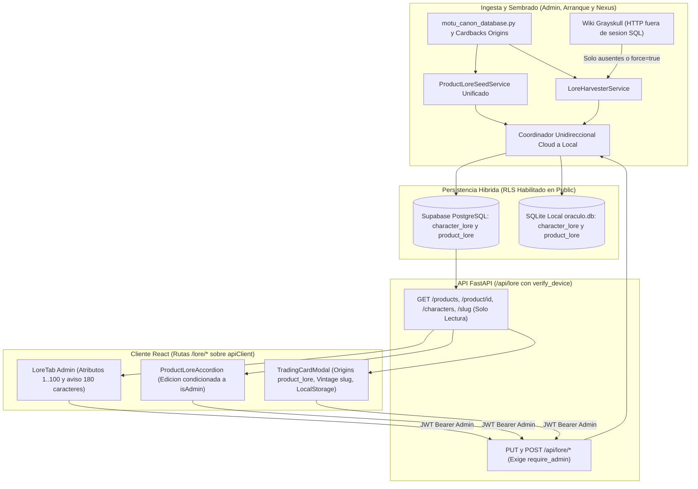

# Grimorio MOTU: Especificación Funcional, Arquitectura y Plan de Consolidación

*   **Author:** DavidLopezGarci4
*   **Status:** Reviewed (Feature Spec Stages 5–8) — Ready for Implementation
*   **Date:** 2026-11-09

---

## Overview

**Oráculo de Nueva Eternia** es una plataforma web y móvil para coleccionistas de figuras de acción de *Masters of the Universe* (**MOTU**). Combina seguimiento automatizado de precios de mercado, gestión privada de inventario y generación de cartas digitales coleccionables estilo juego de cartas intercambiables (**TCG**, *Trading Card Game*).

Dentro de la plataforma, el subsistema **Grimorio MOTU** centraliza las biografías en español, citas de reverso de blíster (*cardbacks* oficiales de Mattel), facciones, temas visuales de marco y cuatro atributos numéricos de combate (`fuerza`, `magia`, `defensa`, `agilidad`) asociados a personajes y figuras del catálogo. Su propósito es servir estos datos desde base de datos sin consumir créditos ni tokens de modelos de lenguaje en cada visualización de ficha o carta digital.

El sistema distingue dos líneas de producto en el catálogo maestro y dos conceptos operativos transversales:

*   **MOTU Origins** (`is_vintage = false` o `null`): reedición moderna iniciada por Mattel en 2020. Cada figura física de esta línea posee una ficha individual en el Grimorio con el lema y texto de su blíster específico.
*   **MOTU Vintage** (`is_vintage = true`): línea original de la década de 1980. Por regla de negocio del proyecto, queda excluida del Grimorio individual por producto (`product_lore`), aunque el visor de cartas TCG consulta el perfil arquetípico del personaje (`character_lore`) como respaldo.
*   **Rol `Master` (`role = "admin"`)**: denominación funcional en manuales e interfaz para el administrador global autenticado mediante token JWT `Bearer` verificado por la dependencia `require_admin`.
*   **Escudo 3OX (`verify_device`)**: mecanismo de control perimetral del backend que exige la cabecera `X-Device-ID` correspondiente a un dispositivo autorizado antes de atender peticiones de clientes autenticados o internos (la vitrina pública sin sesión no consume endpoints del Grimorio).

Este documento establece la especificación consolidada del Grimorio MOTU tras la auditoría sobre la base de código y los manuales ([CONTEXT.md](../CONTEXT.md), [08_configuracion_sistemas.md](../manual_usuario/08_configuracion_sistemas.md), [FAQ_CENTRO_DE_CONTROL.md](../FAQ_CENTRO_DE_CONTROL.md)), y define la arquitectura y plan de implementación para corregir los defectos verificados manteniendo compatibilidad de contratos.

## Problem Statement

El Grimorio MOTU resuelve la necesidad de mostrar textos canónicos en español y estadísticas de combate consistentes en tres superficies autenticadas de la aplicación (catálogo de figuras, inventario privado y generador de cromos TCG) sin llamadas repetidas a APIs externas o modelos generativos.

Tras evolucionar de forma incremental entre fases previas del proyecto, la implementación actual presenta nueve defectos verificados en código que afectan la conectividad cliente-servidor, el control de acceso, la integridad de datos, la paridad híbrida entre bases de datos y la gobernanza de esquema:

1.  **Prefijo HTTP duplicado (`/api/api/lore/*`) en el cliente frontend**: [lore.ts](../../frontend/src/api/lore.ts) importa la instancia compartida `apiClient` (que ya configura `baseURL: '/api'`) e invoca sus ocho rutas anteponiendo de nuevo `'/api/lore/...'`. En ejecución, Axios concatena `/api/api/lore/...`, provocando respuestas `404 Not Found` silenciadas en bloques `catch` tanto en el proxy de desarrollo como en Nginx.
2.  **Control de acceso basado en roles (RBAC) insuficiente en API y Telegram**: los seis endpoints HTTP de mutación global (`PUT` y `POST` bajo `/api/lore`) exigen únicamente un usuario autenticado genérico en lugar de `require_admin`, omiten la validación de dispositivo `verify_device` y permiten a cualquier rol sobrescribir el canon global. En paralelo, [telegram_listener.py](../../src/infrastructure/services/telegram_listener.py) despacha `/lore` y `/harvest_lore` a usuarios `Guardián` no administradores y ejecuta raspado HTTP síncrono sobre el *event loop* principal de `asyncio`, bloqueando el servidor hasta 24 segundos por comando.
3.  **Escrituras laterales en peticiones HTTP `GET`**: la consulta individual `GET /api/lore/product/{product_id}` carece de guarda de dispositivo y ejecuta inserciones con `COMMIT` en base de datos cuando el producto aún no tiene fila en `product_lore`, violando la semántica de solo lectura (método seguro según RFC 9110) de HTTP `GET`.
4.  **Ruptura de inmutabilidad, bloqueo entre sembradores y pérdida de campos**:
    *   La actualización de personaje arquetípico omite persistir el campo `mana_cost` enviado por el cliente.
    *   El sembrador de arranque en [lore_harvester_service.py](../../src/application/services/lore_harvester_service.py) inserta perfiles con `quote` truncado desde la biografía y sella `is_verified = true`, impidiendo que el sembrador canónico de [product_lore_seed.py](../../src/application/services/product_lore_seed.py) propague citas y subtítulos completos con `force = false` y generando colisiones de `slug` con caracteres acentuados sin normalizar (`NFKD`).
    *   La recolección manual de wiki por producto sobrescribe registros con `is_verified = true` y marca como verificados textos crudos extraídos de HTML sin revisión humana.
    *   El guardado desde el visor TCG sobrescribe la cita del blíster (`quote`) con el nombre del ataque especial (`special_move`) y reporta éxito falso cuando un artículo Vintage carece de `slug`.
5.  **Asimetría de sincronización entre PostgreSQL y SQLite**: la arquitectura híbrida exige paridad entre **Supabase PostgreSQL** (`SessionCloud`, fuente primaria en todos los flujos de aplicación, incluido el job nocturno [daily_scan.py](../../src/application/jobs/daily_scan.py) que importa `SessionCloud` bajo el alias `SessionLocal`) y **SQLite local** (`oraculo.db`, respaldo local). Actualmente, solo dos de los seis endpoints HTTP de escritura replican cambios hacia SQLite, omitiendo además replicar `products.character_slug` y las fusiones o borrados de catálogo en [products.py](../../src/interfaces/api/routers/products.py).
6.  **Sentencias `ALTER TABLE` residuales en el arranque de FastAPI**: la función `init_cloud_db()` en [database_cloud.py](../../src/infrastructure/database_cloud.py) ejecuta cinco sentencias `ALTER TABLE character_lore` en cada arranque (diez nodos `ALTER TABLE` totales en el módulo), incumpliendo la invariante de [CONTEXT.md](../CONTEXT.md) que prohíbe DDL en tiempo de arranque sobre el *connection pooler* transaccional (`:6543`) y exige migraciones idempotentes de **Alembic**.
7.  **Deriva de facciones y estructuras estáticas**: coexisten ocho facciones reales en código (incluyendo `Gobernantes de Solaria` y `Alianzas del Multiverso` en 11 personajes crossover), mientras los selectores de interfaz solo listan seis, `Sun-Man` sigue asignado a `Guerreros Heroicos` en los perfiles de cartas y las claves de tema alternan `frame_theme` frente a `theme_key`.
8.  **Peticiones HTTP `400` y fallos de resolución Vintage en el visor TCG**: [CollectionItemDetailModal.tsx](../../frontend/src/components/CollectionItemDetailModal.tsx) no propaga `is_vintage` ni `character_slug` a [TradingCardModal.tsx](../../frontend/src/components/collection/TradingCardModal.tsx), disparando llamadas indebidas al endpoint exclusivo de Origins (`400 Bad Request`) y búsquedas parciales por nombre con sufijo que devuelven listas vacías.
9.  **Deriva en paneles de edición y utilidades operativas**: el frontend no propaga la propiedad `isAdmin` desde [ProductDetailModal.tsx](../../frontend/src/components/catalog/ProductDetailModal.tsx) ni [Collection.tsx](../../frontend/src/pages/Collection.tsx) para ocultar controles de mutación global; [LoreTab.tsx](../../frontend/src/components/config/LoreTab.tsx) omite el indicador visual sobre 180 caracteres y controles de atributos RPG/facción; y la opción `[14]` de [oraculo.ps1](../../oraculo.ps1) describe de forma inexacta el parámetro `force = true` mientras `[12]` omite auditar `product_lore`.

## Goals & Non-Goals

### Goals

*   **G1 — Autorización estricta y conectividad válida**: corregir el prefijo de rutas en el cliente HTTP, proteger todas las rutas de `/api/lore` con `verify_device`, restringir todas las mutaciones globales (`PUT`/`POST` en API y comandos de escritura en Telegram) al rol administrador (`role = "admin"`), y mantener las lecturas `GET` libres de efectos secundarios en base de datos.
*   **G2 — Separación entre canon global y personalización local**: preservar `character_lore` y `product_lore` como enciclopedia canónica compartida administrada por `Master`, propagando `isAdmin` en React para ocultar acciones de mutación global a usuarios estándar mientras sus ajustes locales de carta TCG permanecen en `localStorage`.
*   **G3 — Integridad determinista y sembrador unificado**: unificar el sembrado arquetípico y la generación normalizada de `slug` (`NFKD`), distinguir el canon estático del sistema frente a curaciones humanas reutilizando `is_verified` y `source_url` sin añadir columnas nuevas, responder `409 Conflict` ante intentos de re-cosechar registros verificados sin `force = true`, y preservar de forma independiente `mana_cost`, `quote` y `special_move`.
*   **G4 — Persistencia dual unidireccional (`SessionCloud -> SessionLocal`)**: centralizar un único coordinador secuencial `SessionCloud -> SQLite local` que replique `character_lore`, `product_lore` (incluyendo altas desde [nexus_service.py](../../src/application/services/nexus_service.py), fusiones y borrados de catálogo) y `products.character_slug`, inhibiéndose automáticamente sobre bases en memoria de pruebas.
*   **G5 — Gobernanza de esquema vía Alembic y Zero-Trust RLS**: retirar las sentencias `ALTER TABLE character_lore` del arranque de FastAPI y formalizar mediante migración idempotente de Alembic la existencia de tablas, columnas, índices, activación de **Row-Level Security (RLS)** y revocación de privilegios para `anon` y `authenticated`, actualizando la suite de gobernanza AST.
*   **G6 — Alineación de las 8 facciones canónicas y coherencia UI/documental**: cerrar el catálogo compartido en las ocho facciones existentes sobre los seis marcos visuales actuales (`theme_key`), propagar `is_vintage` y `character_slug` al visor TCG, restituir en los editores administrativos los atributos RPG (`1..100`) y el aviso visual orientativo de 180 caracteres, y sincronizar manuales y CLI.

### Non-Goals

*   **NG1 — Exclusión de línea Vintage**: habilitar fichas individuales en `product_lore` o búsquedas automatizadas de mercado para artículos Vintage (`is_vintage = true`).
*   **NG2 — Cosecha generativa con LLM**: introducir generación automática de biografías con modelos de lenguaje durante el sembrado o la cosecha del Grimorio; la mejora creativa bajo demanda en `/api/cards/ai-enhance` permanece como flujo separado.
*   **NG3 — Almacenamiento multi-inquilino de cartas**: crear tablas por `user_id` en servidor para sincronizar borradores privados de cromos TCG; la personalización individual de usuarios estándar se mantiene en `localStorage`.
*   **NG4 — Rediseño gráfico de plantillas TCG**: alterar la geometría o añadir nuevos archivos gráficos de marco más allá de los seis `theme_key` calibrados en [TcgConfigTab.tsx](../../frontend/src/components/config/TcgConfigTab.tsx).
*   **NG5 — Eliminación del respaldo offline en el visor TCG**: fusionar o suprimir el diccionario estático local de [TradingCardModal.tsx](../../frontend/src/components/collection/TradingCardModal.tsx), el cual se conserva de forma explícita únicamente como respaldo sin conexión cuando la API no responde.

## Critical User Journeys

### CUJ 1: Consulta de reverso de blíster y listado filtrado de figuras Origins

*   **Given**: figuras del catálogo con `is_vintage = false` cuyas filas base en `product_lore` han sido materializadas de forma idempotente en el arranque o al sincronizar el catálogo maestro con Nexus.
*   **When**: un usuario con dispositivo autorizado despliega el acordeón del Grimorio ([ProductLoreAccordion.tsx](../../frontend/src/components/lore/ProductLoreAccordion.tsx)) o consulta `GET /api/lore/products` filtrando por cualquiera de las ocho facciones o texto libre.
*   **Then**: el cliente invoca `/api/lore/...` sin duplicar prefijo y recibe HTTP `200` sin ejecutar `INSERT` ni `COMMIT` durante peticiones `GET` (calculando un respaldo en memoria con `OUTER JOIN` si aún faltase fila); los filtros SQL incluyen todas las figuras Origins sincronizadas y los controles de edición global solo se renderizan cuando `isAdmin` es verdadero.

### CUJ 2: Apertura y edición de cromo TCG para figura Origins frente a figura Vintage

*   **Given**: un usuario abre [TradingCardModal.tsx](../../frontend/src/components/collection/TradingCardModal.tsx) desde su colección para una figura Origins (`is_vintage = false`) o una figura Vintage (`is_vintage = true`).
*   **When**: el visor inicializa los textos y atributos de combate de la carta.
*   **Then**: si `is_vintage = false`, consulta `/api/lore/product/{product_id}` usando el identificador canónico de producto; si `is_vintage = true`, omite el endpoint de Origins (cero errores HTTP `400`) y consulta directamente `/api/lore/{character_slug}` (con respaldo por nombre limpio). Las ediciones de usuarios estándar se guardan únicamente en `localStorage`; los botones de persistencia global y refresco de imagen solo son visibles y autorizados para administradores, guardando en `product_lore` (Origins) o `character_lore` (Vintage) sin pisar `quote` con `special_move` ni mostrar éxito falso si falta `slug`.

### CUJ 3: Curación, cosecha controlada y verificación en el panel Grimorio Lore (Administrador)

*   **Given**: un usuario `Master` (`role = "admin"`) accede a `Configuración > Grimorio Lore` ([LoreTab.tsx](../../frontend/src/components/config/LoreTab.tsx)).
*   **When**: filtra registros pendientes, solicita cosechar desde `he-man.fandom.com` o edita biografía (con aviso visual no bloqueante al superar 180 caracteres), cita, autor, facción, coste simbólico de maná y atributos RPG (`1..100`).
*   **Then**: si solicita re-cosechar sin `force = true` un personaje ya verificado, la API responde `409 Conflict` para exigir confirmación explícita antes de sobrescribir textos en español con extractos web (`is_verified = false`); al guardar cambios manuales, el registro queda sellado como curación administrativa (`is_verified = true`, `source_url = "Curado por Master"`) y se replica de `SessionCloud` a `SessionLocal` incluyendo `mana_cost`.

### CUJ 4: Sembrado incremental e ingesta desatendida en catálogo y jobs

*   **Given**: el servicio de catálogo ([nexus_service.py](../../src/application/services/nexus_service.py)) incorpora figuras nuevas, el job nocturno ([daily_scan.py](../../src/application/jobs/daily_scan.py)) detecta productos sin `character_slug`, o el operador ejecuta las opciones `[12]` / `[14]` en [oraculo.ps1](../../oraculo.ps1).
*   **When**: se ejecuta el sembrado incremental (`force = false`) o el re-sembrado administrativo explícito (`force = true`).
*   **Then**: el sistema vincula `character_slug` normalizado (`NFKD`) excluyendo raspado web sobre artículos Vintage, actualiza el canon estático del sistema sin pisar curaciones humanas salvo `force = true`, materializa filas faltantes de `product_lore`, replica secuencialmente de `SessionCloud` hacia `SessionLocal` fuera del *event loop* asíncrono, y verifica en `[12]` los conteos de `character_lore`, `product_lore` y banderas de estado.

## Proposed Architecture

### System Context & Component Boundaries

El subsistema se organiza respetando la separación en cuatro capas del repositorio:

1.  **Capa de Dominio (`src/domain/`)**:
    *   Modelos ORM ([models.py](../../src/domain/models.py)): `CharacterLoreModel` (tabla `character_lore`, PK `slug`), `ProductLoreModel` (tabla `product_lore`, PK/FK `product_id -> products.id`, relación ORM 1:1 con `delete-orphan`) y enlace `ProductModel.character_slug` junto al identificador único de figura `ProductModel.figure_id`.
    *   Catálogo maestro por ID de figura ([origins_grimorio_by_figure_id.json](../../src/domain/data/origins_grimorio_by_figure_id.json)) y autoridad canónica ([motu_canon_database.py](../../src/domain/motu_canon_database.py)): enlace determinista `O(1)` en caché RAM (`@lru_cache`) para las **338 figuras MOTU Origins** existentes por `products.figure_id` (con impacto **`0 ms`** sobre `/api/products` y `/api/auctions/products`, que no realizan `JOIN` con las tablas de Lore), normalización `NFKD` de `slug`, catálogo cerrado de ocho facciones, seis `theme_key` y matching por frontera alfanumérica (`_has_word_match`) en `resolve_motu_profile`.
2.  **Capa de Aplicación (`src/application/services/` y `src/application/jobs/`)**:
    *   Servicio unificado de sembrado ([product_lore_seed.py](../../src/application/services/product_lore_seed.py)): concentra el sembrado de arquetipos (`character_lore`) y el sembrado *diff-aware* de figuras Origins (`product_lore`, prioridad: JSON por `figure_id` > cardbacks oficiales y `resolve_motu_profile` > fallback real a `CharacterLoreModel`), invocándose en el arranque (`seed_incremental_dual` con `seed_origins_products(..., force=False)`) y al cierre de `NexusService.sync_catalog()` en [nexus_service.py](../../src/application/services/nexus_service.py).
    *   Servicio cosechador y CRUD arquetípico ([lore_harvester_service.py](../../src/application/services/lore_harvester_service.py)): gestiona lecturas/actualizaciones de `character_lore` y ejecuta peticiones HTTP acotadas a `he-man.fandom.com` fuera de transacciones abiertas de base de datos, marcando todo raspado externo nuevo como `is_verified = false`.
    *   Coordinador de persistencia dual unidireccional: encapsula la réplica secuencial *best-effort* desde `SessionCloud` hacia `src.infrastructure.database.SessionLocal` para `character_lore`, `product_lore` y `products.character_slug`, omitiendo la réplica cuando ambos motores coinciden o cuando la sesión primaria es una base en memoria de pruebas.
3.  **Capa de Infraestructura y Gobernanza (`src/infrastructure/` y `migrations/`)**:
    *   Migraciones Alembic (`migrations/versions/`): única vía de evolución de esquema y políticas RLS en PostgreSQL (ejecutada con `NullPool` contra `SUPABASE_DATABASE_URL` y `oraculo.db`), validada en CI por [test_api_db_rls_governance.py](../../tests/unit/test_api_db_rls_governance.py).
    *   Integraciones operativas: comando administrativo `/lore` en [telegram_listener.py](../../src/infrastructure/services/telegram_listener.py) (restringido a `is_admin` y ejecutado en hilo auxiliar) y opciones `[12]` / `[14]` en [oraculo.ps1](../../oraculo.ps1).
4.  **Capa de Interfaces (`src/interfaces/api/` y `frontend/src/`)**:
    *   Router REST ([lore.py](../../src/interfaces/api/routers/lore.py)) montado en [main.py](../../src/interfaces/api/main.py) con `verify_device` global y `require_admin` en mutaciones, coordinado con las operaciones de fusión, edición y borrado de catálogo en [products.py](../../src/interfaces/api/routers/products.py).
    *   Cliente HTTP [lore.ts](../../frontend/src/api/lore.ts) (rutas relativas `/lore/*` sobre `apiClient`) y consumidores React con propagación explícita de `isAdmin`: [LoreTab.tsx](../../frontend/src/components/config/LoreTab.tsx), [ProductLoreAccordion.tsx](../../frontend/src/components/lore/ProductLoreAccordion.tsx) (vía [ProductDetailModal.tsx](../../frontend/src/components/catalog/ProductDetailModal.tsx) y [CollectionItemDetailModal.tsx](../../frontend/src/components/CollectionItemDetailModal.tsx)) y [TradingCardModal.tsx](../../frontend/src/components/collection/TradingCardModal.tsx) (alimentado desde [Collection.tsx](../../frontend/src/pages/Collection.tsx)).

### Data Flow

### Data Model & Schema Governance

El modelo relacional mantiene dos entidades diferenciadas por cardinalidad y reglas de precedencia:

| Entidad | Tabla SQL | Clave Primaria | Alcance Funcional | Regla de Protección e Inmutabilidad |
| :--- | :--- | :--- | :--- | :--- |
| `CharacterLoreModel` | `character_lore` | `slug` (`VARCHAR`, normalizado `NFKD`) | Arquetipo transversal del personaje (ej. `he_man`, `prince_adam`, `sun_man`); respalda figuras Vintage y variantes nuevas. | `is_verified = false` para raspados web pendientes; `is_verified = true` + `source_url = "Canon MOTU Oficial"` para canon del sistema (actualizable sin `force`); `is_verified = true` + `source_url = "Curado por Master"` para ediciones humanas (inmutable salvo `force = true`). |
| `ProductLoreModel` | `product_lore` | `product_id` (`INTEGER`, `FK -> products.id`) | Ficha 1:1 exclusiva de figuras MOTU Origins (`is_vintage = false`); almacena lema y biografía del blíster concreto. | `is_customized` (`BOOLEAN`): protege ediciones manuales frente a re-sembrados salvo `force = true`; se elimina automáticamente si el producto pasa a `is_vintage = true`. |

Ambas tablas comparten el esquema normalizado de atributos tipados: textos descriptivos (`canonical_name`, `subtitle`, `faction`, `theme_key`, `type_line`, `special_move`, `quote`, `flavor_quote_author`, `lore`, `source_url`, `text_color`, `card_version`), coste simbólico de maná (`mana_cost` `VARCHAR`, formato estilo `"{2}{W}{W}"`), cuatro atributos enteros acotados `1..100` (`fuerza`, `magia`, `defensa`, `agilidad`) y marcas temporales UTC (`created_at`, `updated_at`). El contador de `180` caracteres sobre `lore` constituye una guía visual de encaje tipográfico en cromos TCG (aviso ámbar en interfaz, no bloqueante en base de datos).

El catálogo cerrado `VALID_FACTIONS` comprende las **ocho facciones** presentes en el dominio, proyectadas sobre los **seis marcos gráficos existentes** (`theme_key`):

| `faction` (Español) | `theme_key` | Uso Principal |
| :--- | :--- | :--- |
| `Guerreros Heroicos` | `castle_grayskull` | Defensores de Eternia y Castillo Grayskull |
| `Guerreros del Mal` | `snake_mountain` | Fuerzas de Skeletor y Multiverso Anti-Eternia |
| `La Horda del Terror` | `evil_horde` | Fuerzas de Hordak |
| `Los Hombres Serpiente` | `snake_men` | Fuerzas del Rey Hiss |
| `La Gran Rebelión` | `great_rebellion` | Aliados de Etheria y She-Ra |
| `Guardianes Cósmicos` | `cosmic_enforcers` | Entidades cósmicas y sabios de Preternia |
| `Gobernantes de Solaria` | `castle_grayskull` | Sub-línea *Rulers of the Sun* (`Sun-Man` y aliados) |
| `Alianzas del Multiverso` | `castle_grayskull` | Crossovers oficiales (*ThunderCats*, *TMNT*, *WWE*) |

En PostgreSQL (`public`), ambas tablas operan bajo **RLS habilitado** (`ENABLE ROW LEVEL SECURITY`) sin políticas públicas y con `REVOKE ALL` para `anon` y `authenticated`. Las migraciones se aplican mediante `alembic upgrade head` a través de `migrations/env.py` (configurado con `NullPool` para no retener conexiones del pooler) sobre `SUPABASE_DATABASE_URL` y sobre `oraculo.db`.

### API & Authorization Contract

Todos los endpoints se exponen bajo `/api/lore` (invocados desde frontend como `'/lore/...'` sobre `apiClient`):

| Método y Ruta | Guardas de Seguridad | Semántica Determinista y Reglas de Estado |
| :--- | :--- | :--- |
| `GET /api/lore/products` | `verify_device` | Lista paginada (`limit <= 500`) de figuras Origins (`is_vintage = false` o `null`) con `OUTER JOIN` a `product_lore` (`0 ms` de impacto sobre `/api/products`), exposición de `figure_id` y `sub_categories`, búsqueda por nombre/`subtítulo`/`figure_id`/`#product_id` y filtro editorial `customized` (`ALL` \| `CUSTOMIZED` \| `DEFAULT`). |
| `GET /api/lore/product/{product_id}` | `verify_device` | Devuelve `ProductLoreOutput` (incluyendo `figure_id`) para una figura Origins (`404` si no existe, `400` si `is_vintage = true`). Método seguro de solo lectura: nunca ejecuta `INSERT` ni `COMMIT`. |
| `GET /api/lore/characters` (y `GET /api/lore`) | `verify_device` | Lista paginada de `character_lore` filtrable por texto, facción y `pending_only`. |
| `GET /api/lore/{slug}` | `verify_device` | Devuelve `CharacterLoreOutput` por `slug` normalizado o `404` si no existe. |
| `PUT /api/lore/product/{product_id}` | `verify_device` + `require_admin` | Crea o actualiza `product_lore` para una figura Origins (`1..100` en atributos, facción en `VALID_FACTIONS`, limpieza explícita de campos opcionales), marca `is_customized = true` y replica en `SessionLocal`. |
| `PUT /api/lore/{slug}` | `verify_device` + `require_admin` | Actualiza todos los campos editables de `character_lore` (incluido `mana_cost`), fija `is_verified = true` y `source_url = "Curado por Master"`, y replica en `SessionLocal`. |
| `POST /api/lore/harvest` | `verify_device` + `require_admin` | Resuelve o cosecha un personaje (`1..120` caracteres). Si ya está verificado y `force = false`, devuelve `409 Conflict`; si cosecha de wiki externa, ejecuta el HTTP fuera de la sesión SQL, fija `is_verified = false` y replica en `SessionLocal`. |
| `POST /api/lore/harvest-product/{product_id}` | `verify_device` + `require_admin` | Cosecha datos externos para el personaje asociado a `product_id`. Si el personaje ya está verificado y `force = false`, devuelve `409 Conflict` sin consultar la red; con `force = true` actualiza desde wiki marcando `is_verified = false` y replica en `SessionLocal`. |
| `POST /api/lore/harvest-missing` | `verify_device` + `require_admin` | Vincula `character_slug` en productos Origins huérfanos, raspa fuera de la transacción SQL únicamente slugs inexistentes y replica `character_lore` + `products.character_slug` en `SessionLocal`. |
| `POST /api/lore/seed` | `verify_device` + `require_admin` | Ejecuta el sembrado unificado de `character_lore` y `product_lore` en `SessionCloud` y `SessionLocal`. Con `force = false` actualiza el canon del sistema respetando curaciones humanas (`Curado por Master` / `is_customized = true`); con `force = true` sobrescribe todos los registros. |

## Alternatives Considered

### Alternative A: Unificar `character_lore` y `product_lore` en una única tabla SQL polimórfica

*   **Pros**: elimina la repetición de columnas descriptivas entre ambas tablas y reduce esquemas Pydantic de lectura y escritura.
*   **Cons**: rompe la relación ORM existente `ProductModel.lore_entry`, invalida contratos HTTP consumidos por el frontend (`/api/lore/products` y `/api/lore/characters`), mezcla claves primarias incompatibles (`slug` textual frente a `product_id` entero con `FK`) y exige migraciones destructivas sobre PostgreSQL y SQLite.
*   **Reason for Rejection**: el riesgo operativo y de compatibilidad supera el beneficio estructural; mantener ambas tablas para sus cardinalidades reales (arquetipo `1:N` frente a blíster `1:1`) y unificar el servicio de sembrado y persistencia dual resuelve la deriva sin migraciones destructivas.

### Alternative B: Crear una tabla multi-usuario de overrides por `(user_id, product_id)` o sincronización bidireccional con `SyncQueueModel`

*   **Pros**: permitiría sincronizar entre dispositivos las ediciones estéticas hechas por usuarios no administradores y encolar escrituras diferidas entre bases de datos.
*   **Cons**: multiplica el volumen de filas y consultas `JOIN` dependientes de usuario en el catálogo, exige construir un *worker* de cola inexistente para lore y contradice la arquitectura real donde `SessionCloud` es siempre la fuente primaria de escritura y `TradingCardModal` ya aísla las preferencias personales en `localStorage`.
*   **Reason for Rejection**: introduce almacenamiento y orquestación no solicitados (YAGNI); la separación entre canon global administrado por `Master` (con réplica secuencial `Cloud -> Local`) y personalización local en `localStorage` cubre todos los flujos requeridos sin tablas adicionales.

### Alternative C: Reemplazar el cosechador de MediaWiki por generación automática con LLM (Gemini)

*   **Pros**: genera textos directamente en español sin depender de la estructura HTML ni del idioma inglés predominante en `he-man.fandom.com`.
*   **Cons**: introduce coste recurrente por token, dependencia de claves externas en procesos desatendidos, mayor latencia por figura nueva y riesgo de invenciones ajenas al canon oficial de Mattel.
*   **Reason for Rejection**: vulnera el principio de coste cero en ingesta y catálogo del Grimorio y solapa el endpoint opcional `/api/cards/ai-enhance`, que ya ofrece generación asistida bajo acción explícita del usuario.

## Risks & Mitigations

### Riesgo 1: Bloqueo de hilos, agotamiento del pooler `:6543` o abuso de peticiones hacia `he-man.fandom.com`

*   **Descripción**: encadenar hasta tres llamadas HTTP síncronas (`timeout = 8` s, peor caso `24` s por personaje) dentro de sesiones SQL activas o sobre el *event loop* principal de `asyncio` puede agotar conexiones del pooler transaccional de Supabase o congelar FastAPI.
*   **Mitigación**: exigir `require_admin` en todos los endpoints `POST /api/lore/harvest*` y `is_admin` en `/lore` de Telegram, validar longitud (`1..120`), codificar segmentos de ruta con `urllib.parse.quote` contra el host fijo `https://he-man.fandom.com`, cerrar/no abrir sesiones SQL durante llamadas `curl_cffi` y despachar la ejecución síncrona desde contextos `async` mediante `asyncio.to_thread`.

### Riesgo 2: Textos en inglés al cosechar personajes inéditos o sobrescritura accidental de canon en español

*   **Descripción**: `he-man.fandom.com` publica mayoritariamente en inglés; una re-cosecha inadvertida sobre un arquetipo ya curado sustituiría su biografía en español.
*   **Mitigación**: priorizar siempre el catálogo canónico local en español, devolver `409 Conflict` cuando se intente cosechar con `force = false` un registro `is_verified = true` (requiriendo confirmación explícita en interfaz antes de reenviar `force = true`) y marcar toda extracción web como `is_verified = false` para revisión en la bandeja de pendientes.

### Riesgo 3: Divergencia o violación de claves foráneas entre Supabase PostgreSQL y SQLite local

*   **Descripción**: en contenedores efímeros sin `oraculo.db`, en ejecuciones de `pytest` sobre memoria o ante catálogos locales parcialmente sincronizados (`PRAGMA foreign_keys=ON`), una réplica ciega provocaría fallos de clave foránea o contaminaría la base local de desarrollo.
*   **Mitigación**: el coordinador unidireccional confirma primero en `SessionCloud`, omite la réplica si las URLs coinciden o la primaria contiene `"memory"`, comprueba la existencia previa de `ProductModel` en `SessionLocal` antes de replicar `product_lore`, registra `logger.warning` ante indisponibilidad local sin abortar la petición primaria y verifica conteos deterministas de tablas y banderas en la opción `[12]` de [oraculo.ps1](../../oraculo.ps1).

### Riesgo 4: Bloqueos DDL en arranque y rotura de pruebas de gobernanza al añadir migración Alembic

*   **Descripción**: mantener `ALTER TABLE` en `init_cloud_db()` compite por bloqueos exclusivos en el pooler, mientras que añadir una nueva revisión Alembic `head` sin actualizar la aserción estática en [test_api_db_rls_governance.py](../../tests/unit/test_api_db_rls_governance.py) rompería CI.
*   **Mitigación**: retirar las sentencias `ALTER TABLE character_lore` de [database_cloud.py](../../src/infrastructure/database_cloud.py), trasladar el esquema e invariantes RLS a una migración idempotente de Alembic encadenada tras `9b4c7d8e1f2a`, y actualizar [test_api_db_rls_governance.py](../../tests/unit/test_api_db_rls_governance.py) para resolver dinámicamente `get_current_head()` y rebajar el techo AST de `ALTER TABLE` de `10` a `5`.

---

## Detailed Implementation Plan

### Target Scope & File Boundary

La siguiente tabla enumera todos los archivos que se crearán o modificarán durante la implementación (lista cerrada de escritura):

| Archivo (Ruta Relativa al Repositorio) | Acción | Capa / Componente | Propósito y Justificación del Cambio |
| :--- | :--- | :--- | :--- |
| `migrations/versions/<rev>_consolidate_lore_schema_and_rls.py` | Create | Infraestructura / Alembic | Migración idempotente (`down_revision = "9b4c7d8e1f2a"`) que garantiza tablas, columnas e índices de `character_lore` y `product_lore`, junto con `ENABLE ROW LEVEL SECURITY` y `REVOKE ALL` para `anon, authenticated` en PostgreSQL. |
| [database_cloud.py](../../src/infrastructure/database_cloud.py) | Modify | Infraestructura / DB | Retirar las sentencias `ALTER TABLE character_lore` (rama PostgreSQL y llamadas SQLite equivalentes) de `init_cloud_db()`, reduciendo los nodos AST `ALTER TABLE` del módulo de 10 a 5. |
| [motu_canon_database.py](../../src/domain/motu_canon_database.py) | Modify | Dominio | Definir `canonicalize_slug` con normalización Unicode `NFKD`, cerrar `VALID_FACTIONS` (8 facciones) y `FACTION_TO_THEME` (6 `theme_key`), reclasificar *Rulers of the Sun* (`Sun-Man` y aliados) a `Gobernantes de Solaria` y normalizar la salida de `resolve_motu_profile`. |
| [product_lore_seed.py](../../src/application/services/product_lore_seed.py) | Modify | Aplicación / Sembrado | Unificar el sembrado de `character_lore` (respetando `source_url == "Curado por Master"` cuando `force = false` y purgando slugs corruptos sin verificar como `prncipe_adam`) y el sembrado incremental de `product_lore`, integrando el coordinador unidireccional `SessionCloud -> SessionLocal`. |
| [lore_harvester_service.py](../../src/application/services/lore_harvester_service.py) | Modify | Aplicación / Cosecha | Persistir `mana_cost` y `source_url = "Curado por Master"` en `update_character`, lanzar conflicto cuando `is_verified = true` y `force = false` en cosechas, extraer llamadas `curl_cffi` fuera de sesiones SQL, codificar fallback URL con `urllib.parse.quote`, delegar el sembrado inicial al servicio unificado e invocar réplica dual. |
| [nexus_service.py](../../src/application/services/nexus_service.py) | Modify | Aplicación / Catálogo | Ejecutar el sembrado incremental dual de `character_slug` y `product_lore` (`force = false`) al finalizar `sync_catalog()`, garantizando que toda figura Origins nueva quede materializada para filtros SQL. |
| [daily_scan.py](../../src/application/jobs/daily_scan.py) | Modify | Aplicación / Jobs | Filtrar `is_vintage == false` antes de cosechar personajes huérfanos, ejecutar la rutina síncrona mediante `asyncio.to_thread` con commits por lote y replicar de `SessionCloud` hacia `src.infrastructure.database.SessionLocal`. |
| [telegram_listener.py](../../src/infrastructure/services/telegram_listener.py) | Modify | Infraestructura / Telegram | Trasladar `/lore` y `/harvest_lore` dentro del bloque `elif is_admin:`, validar longitud `1..120`, ejecutar la cosecha en hilo auxiliar con `asyncio.to_thread` y replicar `character_lore` + `products.character_slug` en `SessionLocal`. |
| [lore.py](../../src/interfaces/api/routers/lore.py) | Modify | Interfaces / API | Aplicar `Depends(verify_device)` al router, exigir `Depends(require_admin)` en los 6 endpoints `PUT`/`POST`, convertir `GET /product/{product_id}` en lectura pura sin escritura, añadir `OUTER JOIN` a `CharacterLoreModel` y campos completos en `GET /products`, devolver `409 Conflict` en cosechas protegidas (`force = false`) y validar rangos `1..100`, `max_length` y `VALID_FACTIONS` usando `exclude_unset=True`. |
| [products.py](../../src/interfaces/api/routers/products.py) | Modify | Interfaces / API | Sincronizar en `SessionLocal` las transferencias y borrados de `product_lore` en `merge_products` y `delete_product`, y eliminar `product_lore` si un producto es o pasa a `is_vintage = true` en `merge_products` o `edit_product`. |
| [main.py](../../src/interfaces/api/main.py) | Modify | Interfaces / Startup | Invocar en `lifespan` el sembrado incremental dual unificado (`character_lore` + `product_lore` faltantes en `SessionCloud` y `SessionLocal`) sin bloqueos mutuos. |
| [oraculo.ps1](../../oraculo.ps1) | Modify | Operaciones / CLI | Unificar orden `Cloud -> Local` y mensaje preciso de `force = true` en `[14]` (y su entrada de ayuda en `[15]`), y añadir conteos de `product_lore`, `is_verified` e `is_customized` a la tabla y condición booleana de paridad en `[12]`. |
| [lore.ts](../../frontend/src/api/lore.ts) | Modify | Frontend / API Client | Corregir las 8 rutas de `'/api/lore/...'` a `'/lore/...'` sobre `apiClient`, exportar `MOTU_FACTIONS` (8 facciones) y `FACTION_TO_THEME`, completar tipos de `ProductLoreListItem` y soportar `force?: boolean` en cosecha. |
| [ProductDetailModal.tsx](../../frontend/src/components/catalog/ProductDetailModal.tsx) | Modify | Frontend / Catálogo | Propagar la prop `isAdmin` ya recibida hacia `<ProductLoreAccordion />`. |
| [Collection.tsx](../../frontend/src/pages/Collection.tsx) | Modify | Frontend / Colección | Propagar `isAdmin` (ya calculado con `isUserAdmin(user)`) hacia `<CollectionItemDetailModal />`. |
| [CollectionItemDetailModal.tsx](../../frontend/src/components/CollectionItemDetailModal.tsx) | Modify | Frontend / Colección | Recibir `isAdmin` y propagarlo a `<ProductLoreAccordion />` y `<TradingCardModal />`, incluyendo `product_id`, `is_vintage` y `character_slug` en el objeto `item` del visor TCG. |
| [TradingCardModal.tsx](../../frontend/src/components/collection/TradingCardModal.tsx) | Modify | Frontend / TCG | Resolver cartas Vintage mediante `character_slug -> GET /lore/{slug}` (con fallback limpio), usar `productId` en todas las acciones/imágenes de producto, guardar Origins en `PUT /lore/product/{productId}` y Vintage en `PUT /lore/{slug}` sin sobrescribir `quote` con `special_move` ni fingir éxito sin `slug`, alinear inputs RPG a `1..100` y restringir botones globales (`Guardar en BD`, `Cosechar`, `Refrescar Imagen AF411`) a `isAdmin`. |
| [ProductLoreAccordion.tsx](../../frontend/src/components/lore/ProductLoreAccordion.tsx) | Modify | Frontend / Lore UI | Corregir orden de hooks antes de `if (isVintage) return null;`, usar las 8 facciones sincronizando `theme_key` al cambiar facción, mostrar `Editar Lore` solo si `isAdmin` y añadir indicador visual sobre 180 caracteres. |
| [LoreTab.tsx](../../frontend/src/components/config/LoreTab.tsx) | Modify | Frontend / Admin UI | Incorporar las 8 facciones, paginación real (`PAGE_SIZE = 50` sobre las 338+ figuras sin truncar en 150), filtros de subcategoría/wave y estado editorial, badges `AF411 #{figure_id}` + `ID #{product_id}`, selector rápido de bando a 1 clic optimista y editor completo. |
| `src/domain/data/origins_grimorio_by_figure_id.json` | Create | Dominio / Datos | Catálogo maestro inmutable en caché RAM con las **338 figuras Origins** enlazadas de forma unívoca por `products.figure_id`, con nombres de variante auténticos, bios `65..180` caracteres y bandos canónicos exactos. |
| [08_configuracion_sistemas.md](../manual_usuario/08_configuracion_sistemas.md) | Modify | Documentación | Actualizar manual del Grimorio Lore reflejando las dos vistas, las ocho facciones, el aviso orientativo de 180 caracteres y las reglas de inmutabilidad. |
| [FAQ_CENTRO_DE_CONTROL.md](../FAQ_CENTRO_DE_CONTROL.md) | Modify | Documentación | Alinear la descripción de las opciones `[12]` y `[14]` con el conteo dual de `product_lore` y el efecto real de `force = true`. |
| [test_api_db_rls_governance.py](../../tests/unit/test_api_db_rls_governance.py) | Modify | Tests Gobernanza / CI | Resolver dinámicamente `ScriptDirectory.from_config(cfg).get_current_head()` tras `alembic upgrade head` y reducir el techo AST permitido de `ALTER TABLE` en `database_cloud.py` de `10` a `5`. |
| [conftest.py](../../tests/conftest.py) | Modify | Infraestructura Tests | Registrar `src.interfaces.api.routers.lore.SessionCloud`, `src.interfaces.api.main.SessionCloud` y `src.infrastructure.database.SessionLocal` en el aislamiento en memoria para impedir cualquier escritura accidental en `oraculo.db`. |
| [test_lore_harvester.py](../../tests/unit/test_lore_harvester.py) | Modify | Tests Unitarios | Ampliar pruebas de `canonicalize_slug` (`NFKD`), las 8 facciones (`Sun-Man -> Gobernantes de Solaria`, crossovers -> `Alianzas del Multiverso`), persistencia de `mana_cost`, distinción `Canon MOTU Oficial` vs `Curado por Master` y bloqueo de re-cosecha sin `force`. |
| `tests/unit/test_api_lore_security_and_contracts.py` | Create | Tests API / Seguridad | Suite hermética de contratos HTTP y seguridad: `verify_device` (`403` sin `X-Device-ID`), `require_admin` (`403` para rol `user` en los 6 `PUT`/`POST`), pureza `GET` sin escrituras, filtrado SQL completo de figuras Origins nuevas, `409 Conflict` en cosecha verificada sin `force`, exclusión Vintage (`400`) y consultas acotadas en `harvest-missing`. |

Archivos base verificados de solo lectura que no requieren modificación: [CONTEXT.md](../CONTEXT.md), [models.py](../../src/domain/models.py), [deps.py](../../src/interfaces/api/deps.py), [TcgConfigTab.tsx](../../frontend/src/components/config/TcgConfigTab.tsx) y [test_api_perf_wu6_pipeline_currency_startup.py](../../tests/test_api_perf_wu6_pipeline_currency_startup.py).

### Actionable Work Units

#### Work Unit 1: Migración Alembic, Gobernanza RLS y Aislamiento de Tests

1.  **Migración idempotente en `migrations/versions/`**: encadenar la nueva revisión tras `9b4c7d8e1f2a` verificando con el inspector de SQLAlchemy la existencia de `character_lore`, `product_lore`, sus columnas añadidas (`subtitle`, `flavor_quote_author`, `text_color`, `card_version`, `mana_cost`) y sus cuatro índices; en dialecto PostgreSQL ejecutar `ENABLE ROW LEVEL SECURITY` y `REVOKE ALL ... FROM anon, authenticated` sobre ambas tablas, con `downgrade()` no destructivo (`pass`).
2.  **Limpieza de arranque y suite de gobernanza**: retirar las sentencias `ALTER TABLE character_lore` en [database_cloud.py](../../src/infrastructure/database_cloud.py), ajustar [test_api_db_rls_governance.py](../../tests/unit/test_api_db_rls_governance.py) (revisión `head` dinámica y techo AST `<= 5`) y aislar `SessionCloud`/`SessionLocal` de Lore en [conftest.py](../../tests/conftest.py).

#### Work Unit 2: Dominio Canónico Unificado, Sembrado Incremental y Coordinador Dual

1.  **Normalización en [motu_canon_database.py](../../src/domain/motu_canon_database.py)**: implementar `canonicalize_slug` con desacentuar `NFKD`, exportar `VALID_FACTIONS` (8 facciones) y `FACTION_TO_THEME` (6 temas), asignar *Rulers of the Sun* a `Gobernantes de Solaria` y asegurar que `resolve_motu_profile` devuelva siempre `theme_key`, `subtitle`, `quote`, `flavor_quote_author` y `mana_cost`.
2.  **Coordinador dual y sembrador unificado en [product_lore_seed.py](../../src/application/services/product_lore_seed.py) y [lore_harvester_service.py](../../src/application/services/lore_harvester_service.py)**:
    *   Implementar el adaptador secuencial `SessionCloud -> src.infrastructure.database.SessionLocal` (inhibido si las URLs coinciden o si la primaria contiene `"memory"`) para `character_lore`, `product_lore` (verificando existencia previa de `ProductModel` local) y `products.character_slug`.
    *   Unificar el sembrado arquetípico sobre `CANONICAL_CARD_PROFILES` + `MOTU_LORE_ENCYCLOPEDIA` con `source_url = "Canon MOTU Oficial"`, permitiendo que `force = false` actualice filas del sistema y limpie slugs corruptos no curados (`prncipe_adam`) sin tocar jamás registros con `source_url = "Curado por Master"`.
    *   Extraer las peticiones HTTP `curl_cffi` fuera de sesiones SQL activas, codificar rutas fallback con `urllib.parse.quote`, conservar `mana_cost` en `update_character` (fijando `source_url = "Curado por Master"`) y lanzar conflicto de dominio cuando se intente cosechar un personaje verificado con `force = false`.
3.  **Fronteras de ingesta y operaciones ([main.py](../../src/interfaces/api/main.py), [nexus_service.py](../../src/application/services/nexus_service.py), [daily_scan.py](../../src/application/jobs/daily_scan.py), [oraculo.ps1](../../oraculo.ps1))**: ejecutar el sembrado incremental dual en `lifespan` y al cierre de `NexusService.sync_catalog()`, excluir artículos Vintage y envolver con `asyncio.to_thread` la resolución en `daily_scan.py`, y actualizar los conteos/mensajes de `[12]`, `[14]` y `[15]` en `oraculo.ps1`.

#### Work Unit 3: Endurecimiento de `/api/lore`, Catálogo `products.py` y Telegram

1.  **Router [lore.py](../../src/interfaces/api/routers/lore.py)**: añadir `Depends(verify_device)` a nivel de router y `Depends(require_admin)` en los seis endpoints `PUT`/`POST`; convertir `GET /product/{product_id}` en lectura sin escrituras; enriquecer `GET /products` con `OUTER JOIN` a `CharacterLoreModel` y atributos completos; responder `409 Conflict` ante cosechas sobre registros verificados con `force = false`; y validar `1..100`, `VALID_FACTIONS` y `max_length` aplicando actualizaciones con `exclude_unset=True`.
2.  **Sincronización en [products.py](../../src/interfaces/api/routers/products.py) y [telegram_listener.py](../../src/infrastructure/services/telegram_listener.py)**: replicar en `SessionLocal` las fusiones/borrados de `product_lore` y purgar `product_lore` si `is_vintage` pasa a `true`; mover `/lore` y `/harvest_lore` bajo `elif is_admin:` ejecutando la cosecha con `asyncio.to_thread`.

#### Work Unit 4: Corrección de Cliente Axios, Cadena `isAdmin` y Superficies React

1.  **Cliente [lore.ts](../../frontend/src/api/lore.ts) y propagación de `isAdmin`**: normalizar las 8 rutas a `'/lore/...'`, exportar `MOTU_FACTIONS` y `FACTION_TO_THEME`, y propagar `isAdmin` desde [ProductDetailModal.tsx](../../frontend/src/components/catalog/ProductDetailModal.tsx) y [Collection.tsx](../../frontend/src/pages/Collection.tsx) hacia [CollectionItemDetailModal.tsx](../../frontend/src/components/CollectionItemDetailModal.tsx), [ProductLoreAccordion.tsx](../../frontend/src/components/lore/ProductLoreAccordion.tsx) y [TradingCardModal.tsx](../../frontend/src/components/collection/TradingCardModal.tsx).
2.  **Corrección de [TradingCardModal.tsx](../../frontend/src/components/collection/TradingCardModal.tsx), [ProductLoreAccordion.tsx](../../frontend/src/components/lore/ProductLoreAccordion.tsx) y [LoreTab.tsx](../../frontend/src/components/config/LoreTab.tsx)**: resolver cartas Vintage por `character_slug`, usar `productId` en todas las llamadas e imágenes de producto, separar el guardado global Origins (`PUT /lore/product/{productId}`) frente a Vintage (`PUT /lore/{slug}`) preservando `quote`, ocultar acciones administrativas cuando `!isAdmin`, corregir el orden de hooks en `ProductLoreAccordion.tsx` y completar los formularios y avisos de 180 caracteres en `LoreTab.tsx`.

#### Work Unit 5: Sincronización Documental y Verificación Automatizada

1.  **Documentación**: actualizar [08_configuracion_sistemas.md](../manual_usuario/08_configuracion_sistemas.md) y [FAQ_CENTRO_DE_CONTROL.md](../FAQ_CENTRO_DE_CONTROL.md) con las ocho facciones, las dos vistas del Grimorio, el aviso orientativo de 180 caracteres y el comportamiento de `force` y `[12]`.
2.  **Pruebas automatizadas y compilación**: completar [test_lore_harvester.py](../../tests/unit/test_lore_harvester.py) y la nueva suite `tests/unit/test_api_lore_security_and_contracts.py`.

### Test Plan

La implementación deberá superar el 100 % de las siguientes suites automatizadas sin tocar `oraculo.db` en disco:

1.  **Gobernanza de Esquema y RLS (`pytest tests/unit/test_api_db_rls_governance.py -v`)**:
    *   Verifica mediante análisis AST que la nueva migración aplica `ENABLE ROW LEVEL SECURITY` y `REVOKE ALL` sin contener `DISABLE ROW LEVEL SECURITY`, alcanza el `head` actual con `alembic upgrade head` sobre esquemas precreados y confirma que los nodos AST `ALTER TABLE` en [database_cloud.py](../../src/infrastructure/database_cloud.py) quedan acotados en `<= 5` (cero de `character_lore`).
2.  **Pruebas Unitarias de Dominio, Sembrado y Cosechador (`pytest tests/unit/test_lore_harvester.py -v`)**:
    *   Verifica `canonicalize_slug` con tildes (`"Príncipe Adam" -> "principe_adam"`), resolución de las 8 facciones (`Sun-Man -> Gobernantes de Solaria`, `Lion-O -> Alianzas del Multiverso`), persistencia de `mana_cost` y `source_url = "Curado por Master"` en `update_character`, preservación de registros curados frente a sembrados con `force = false` y bloqueo de re-cosecha web sin `force` (`is_verified = false` cuando se fuerza).
3.  **Pruebas de Contrato HTTP, Seguridad RBAC y Hermeticidad (`pytest tests/unit/test_api_lore_security_and_contracts.py -v`)**:
    *   Verifica rechazo `403 Forbidden` sin `X-Device-ID` válido en `GET /api/lore/*`, rechazo `403 Forbidden` para JWT de rol `user` en los 6 endpoints `PUT`/`POST` (`200 OK` para rol `admin`), cero filas insertadas tras `GET /api/lore/product/{id}`, filtrado SQL completo por facción tras sembrado incremental, respuesta `409 Conflict` al cosechar un registro verificado con `force = false`, rechazo `400 Bad Request` para artículos Vintage en `/api/lore/product/{id}`, validación `422` fuera de `1..100` o `VALID_FACTIONS`, consultas acotadas en `POST /api/lore/harvest-missing` e invariabilidad del hash/mtime de `oraculo.db`.
4.  **Regresión de Rendimiento de Arranque (`pytest tests/test_api_perf_wu6_pipeline_currency_startup.py -v`)**:
    *   Verifica que el sembrado incremental de arranque mantiene coste acotado en segundas pasadas (`linked_products == 0`).
5.  **Compilación y Tipado Estricto de Frontend (`npm --prefix frontend run build`)**:
    *   Ejecuta `tsc -b && vite build` sin errores de tipos en todos los componentes y verifica que ninguna ruta en [lore.ts](../../frontend/src/api/lore.ts) comienza con `/api/`.
